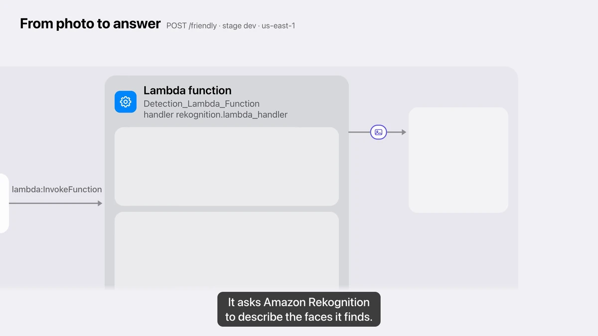

# Serverless profile-photo checker — Lambda + API Gateway + Rekognition

<p align="center">
  <a href="https://andyyaro.github.io/serverless-profile-photo-checker/film.html"></a>
</p>

<p align="center"><b>Watch the 66-second launch film:</b> <a href="https://andyyaro.github.io/serverless-profile-photo-checker/film.html">with sound and captions</a> · <a href="https://andyyaro.github.io/serverless-profile-photo-checker/film/photo-checker-launch.mp4">MP4, 10.9 MB</a> · <a href="media/launch-film/">how it was made</a></p>

A small serverless API that takes a base64-encoded image, runs Amazon Rekognition
face detection over it, and answers one question: is this usable as a profile photo?

Provisioned as Infrastructure as Code — 14 Terraform resources covering the function, its
execution role, a least-privilege logging policy, and the full API Gateway integration chain.

Built during the **InternPass Cloud Computing research internship** (June–July 2025). Extracted
here from the shared team repository so the work stands on its own.

---

## What it does

```
POST /  { base64 image }
   → Lambda
   → rekognition.detect_faces(Attributes=['ALL'])
   → "Good Profile Photo" | "Bad Profile Photo"
```

The classification rule is deliberately narrow. A photo passes only when Rekognition reports
**exactly one face**, that face is **smiling**, and its **eyes are open**:

```python
if len(rekognition_response['FaceDetails']) != 1:
    raise ValueError('Please upload a picture with only one face')

smile    = rekognition_response['FaceDetails'][0]['Smile']
eyesOpen = rekognition_response['FaceDetails'][0]['EyesOpen']

result = 'Bad Profile Photo'
if smile['Value'] == True and eyesOpen['Value'] == True:
    result = 'Good Profile Photo'
```

Rejecting multi-face images *before* classifying matters: with two people in frame, "the face"
is ambiguous, and silently picking `FaceDetails[0]` would give a confident answer about whichever
face the service happened to return first.

Errors are differentiated rather than collapsed into one 500 — a `botocore` `ClientError` (the
call to Rekognition failed) and a `ValueError` (the image was unusable) return distinct
`Error` / `ErrorMessage` payloads, and both log the invoked function ARN so a failure can be
traced back to a specific invocation.

> **Attribution.** The handler's scaffolding — the base64 branch and the dual-exception
> structure — follows AWS's published example for calling Rekognition from Lambda. The
> single-face guard and the Smile + EyesOpen classifier are mine.

---

## Infrastructure

`lambda.tf` and `apigw.tf` are 163 lines provisioning 14 resources:

| Group | Resources |
|---|---|
| Function | `aws_lambda_function`, `aws_iam_role`, inline CloudWatch Logs policy, attachment of the AWS-managed `AmazonRekognitionReadOnlyAccess` policy |
| API | `aws_api_gateway_rest_api`, `_resource`, `_method`, `_integration`, `_integration_response`, `_deployment`, `_stage` |

The function is granted **read-only** Rekognition access and nothing else beyond writing its own
logs.

### Redeployment without downtime

API Gateway will happily leave a stage pointing at a stale deployment when the underlying
resources change. The deployment is therefore triggered by a hash of the things that actually
affect it, and replaced before the old one is destroyed:

```hcl
triggers = {
  redeployment = sha1(jsonencode([ ... resource, method, integration ... ]))
}

lifecycle {
  create_before_destroy = true
}
```

---

## Contents

```
python/rekognition.py   the Lambda handler
interact.py             argparse CLI: base64-encodes a local image, POSTs it,
                        and branches its output on the returned statusCode
lambda.tf               function, execution role, policies
apigw.tf                REST API, method, integration, deployment, stage
Dockerfile              python:3.9-slim, requirements-first COPY for layer caching
goodphoto.jpeg          fixture that should pass
badphoto.png            fixture that should fail
quotes-service/         a second small service from the same internship, packaged
                        with Docker and deployed to the team's RKE2 cluster on EC2
                        via the Kubernetes Deployment manifest included there
media/launch-film/      the 66-second launch film's source: composition, narration,
                        sound, every claim with its source, and the watch page
```

---

## Running it

```bash
cd .
terraform init
terraform plan
terraform apply

python interact.py --image goodphoto.jpeg --url "$(terraform output -raw api_url)"
```

Requires AWS credentials with permission to manage Lambda, IAM and API Gateway, in a region
where Rekognition is available.

---

## Scope

This was a short research internship, and the repository is what it is: two small services, real
Terraform, real container packaging, and no automated tests. The `quotes-service/` Kubernetes
manifest was applied to a cluster the team ran; provisioning that cluster was not my work.

**The launch film** (2026-11-02) walks through the code and the Terraform as they are, without
deploying anything; its source is in [`media/launch-film/`](media/launch-film/).
